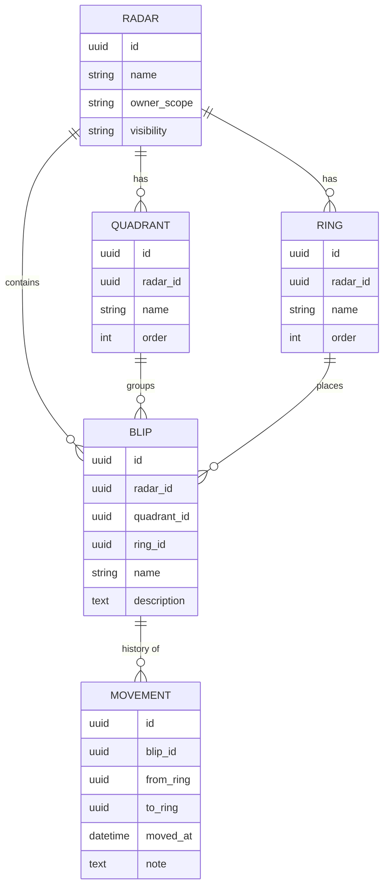

# Radar App — Architecture

## Guiding principle

The **radar and its store are the center**. Everything else — import, export, feeds,
classification, and the UI — is an adapter that reads from or writes to that core. This
keeps the domain small and lets capabilities be added without reworking the middle.

## Domain model

Five nouns. If these are clean, custom quadrants, teams, movement history, and BYOR export
all follow easily.



- **RADAR** — a named radar with a scope (solo / team / department) and visibility.
- **QUADRANT** — a named, ordered division of a radar (e.g. Languages & Frameworks). Data,
  not hardcoded.
- **RING** — a named, ordered band of a radar (e.g. Adopt / Trial / Assess / Hold). Data,
  not hardcoded.
- **BLIP** — an item placed on the radar at one quadrant and one ring, with a description.
- **MOVEMENT** — a record of a blip changing ring/quadrant (`from`, `to`, `at`, `note`),
  forming its history.

### Two load-bearing choices

1. **Quadrants and rings are data.** A radar owns its quadrants and rings as rows, so users
   can name and order their own. A ThoughtWorks-style layout (four quadrants, four rings)
   ships as the **default template**; nothing in the model assumes it.
2. **Blips retain movement history.** Each ring/quadrant change writes a `MOVEMENT` row.
   This powers "what changed" views and trend, and keeps an ordered trail that later,
   higher-level views (e.g. a growth/skill map) can build on.

## System architecture

```
        IMPORT adapters                 EXPORT adapters
   ┌────────────────────────┐       ┌─────────────────────┐
   │ BYOR / CSV file         │       │ BYOR JSON (render)  │
   │ public-doc URL          │       │ CSV / file          │
   │ external-radar scrape   │       │ shareable link      │
   └──────────┬─────────────┘       └─────────▲───────────┘
              │                                │
              ▼                                │
        ┌──────────────────────────────────────────────┐
        │   AUTHORING CORE  (domain model + store/DB)     │
        │   radars · quadrants · rings · blips · moves    │
        └──────────────────────────────────────────────┘
              ▲                                ▲
              │                                │
   ┌──────────┴─────────────┐       ┌──────────┴──────────┐
   │ SUGGESTION adapters     │       │  WEB UI             │
   │ feeds → candidate blips │       │  view + edit + move │
   │ classifier / LLM        │       │  blips between rings │
   └────────────────────────┘       └─────────────────────┘
```

| Component               | Responsibility                                                                    |
| ----------------------- | --------------------------------------------------------------------------------- |
| **Authoring core**      | The domain model and its persistence. Source of truth for every radar.            |
| **Web UI**              | View a radar and edit it directly (add/move/rename/delete blips).                 |
| **Import adapters**     | Turn external formats (BYOR/CSV files, public-doc URLs, scrapes) into radar data. |
| **Export adapters**     | Emit BYOR JSON / CSV / shareable links from radar data.                           |
| **Suggestion adapters** | Turn feeds and a classifier/LLM into _candidate_ blips for review.                |

The database is the **source of truth**; files and URLs are import/export only.

## Tech stack

| Layer        | Choice                         | Notes                                                                                        |
| ------------ | ------------------------------ | -------------------------------------------------------------------------------------------- |
| Language     | Python                         | Poetry, pyright strict                                                                       |
| API          | FastAPI                        | REST over the authoring core                                                                 |
| Database     | PostgreSQL                     | SQLite acceptable for the first local slice                                                  |
| Domain       | pydantic models                | Domain types and validation                                                                  |
| Front-end    | **Undecided**                  | Must render an SVG radar and support drag-between-rings editing; decide before the UI slice. |
| Default look | ThoughtWorks-style, own design | Ships as a template; more templates later                                                    |

## Design decisions

- **The database is the source of truth; files/URLs are import/export.** In-UI editing is
  the primary workflow; BYOR compatibility is preserved through export; file-based users
  keep a familiar on-ramp.
- **Quadrants and rings are first-class data.** Enables custom radars from day one; the
  ThoughtWorks-style layout is one template among future many.
- **Blips keep movement history.** A small `MOVEMENT` table unlocks trend, "what changed",
  and later growth views without changing the rest of the model.
- **One app; scope is a property of a radar.** Solo, team, and department share one build;
  multi-user grows in via `owner_scope` / `visibility` without a rewrite.
- **Feeds and classification are adapters, not the core.** They propose candidate blips
  into a review queue; the radar remains hand-authored and authoritative.
- **Python + FastAPI + PostgreSQL for the backend; front-end deferred.** The interactive
  drag-between-rings editor is the decisive front-end requirement and is chosen
  deliberately before the UI slice.

## See also

- [product-spec.md](./product-spec.md) — problem, users, and capabilities.
- [roadmap.md](./roadmap.md) — planned capabilities.
