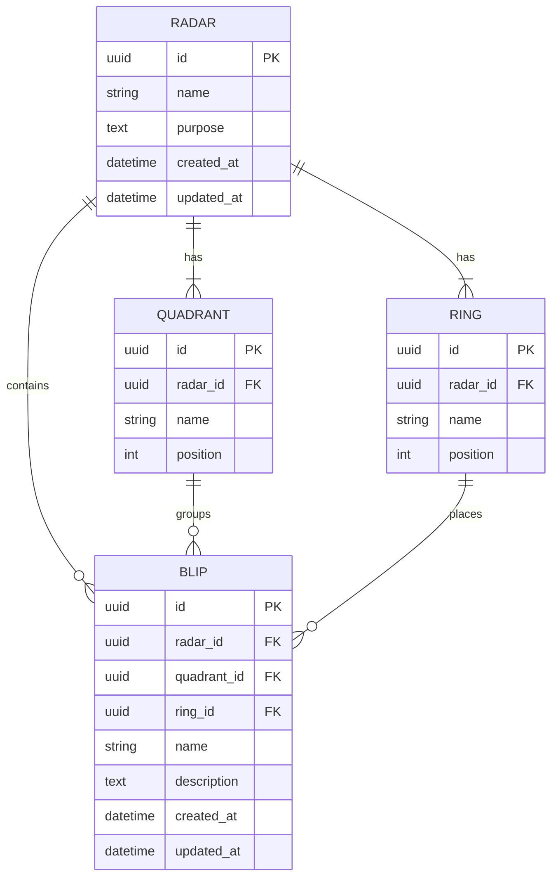
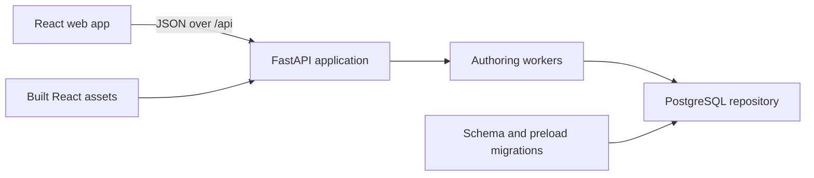

# Radarsmith — Architecture

## Guiding principle

The **radar store is the source of truth**. The MVP has one authoring path through the
web application; files, external sources, collaboration, and historical analysis stay
outside the core until their product behavior is defined.

## MVP domain model

The MVP needs four domain entities. It stores quadrant and ring structure as data even
though the first UI creates only the fixed default template. This preserves a clean path
to custom structures without making that upgrade part of the first release.

- **Radar** — a named collection expressing one current stance. `purpose` is optional.
- **Quadrant** — an ordered category owned by one radar.
- **Ring** — an ordered level of recommendation owned by one radar; lower positions are
  rendered nearer the center.
- **Blip** — a named item placed in exactly one quadrant and one ring of the same radar.
  Its description is required plain text.

The worker layer enforces cross-row invariants that foreign keys alone cannot express:
a blip's quadrant and ring must belong to its radar, names must not be blank, and
positions must be unique within a radar. Deleting a radar deletes its structure and
blips. Blip deletion is explicit and confirmed by the UI.

There is deliberately no `Movement`, `Edition`, `User`, `OwnerScope`, or `Visibility` in
the MVP model. Repositioning a blip updates its current placement. History will be
modeled as comparisons between immutable editions when that workflow is designed, not
as a log of every draft edit.

## Application shape

| Component | Responsibility |
| --- | --- |
| **React web app** | Radar library, responsive workspace, forms and table, SVG rendering, and save/error feedback. |
| **FastAPI application** | REST boundary, request validation, authoring use cases, and production static-asset serving. |
| **Authoring workers** | Create and mutate valid radars and blips without depending on HTTP or rendering concerns. |
| **PostgreSQL repository** | Persist the current state and enforce relational constraints. |
| **Migrations** | Evolve the schema and insert the bundled radar exactly once on a clean database. |

### Backend layout

The backend is organised in these layers:

| Layer | Location | Responsibility |
| --- | --- | --- |
| Endpoints | `app/api/api_v1/endpoints/`, routed by `app/api/api_v1/api.py` | HTTP boundary: path/body parsing and response models only. Shared path parameters live in `app/api/api_v1/path_params.py`. |
| Workers | `app/api/workers/` (`RadarApi`, `BlipApi`) | Use cases and cross-row invariants; own the transaction boundary for multi-step writes. |
| CRUD | `app/crud/` (`RadarDb`, `BlipDb`, …) | SQLAlchemy queries for one table each. |
| Domain | `app/domain/` | Exceptions, enums, defaults, and the preload artifact. |
| Schemas / models | `app/schemas/`, `app/models/` | Pydantic DTOs and SQLAlchemy models. |

Single-step CRUD methods commit their own change. A worker that spans several writes
flushes through the CRUD layer and commits once, using `try: commit` /
`finally: rollback` so a failure never leaves partial state in the session.

Domain exceptions live in `app/domain/exceptions.py` and `app/api/error_handlers.py` maps
them to one envelope, `{"error": {"code", "message"}}`, which the frontend client depends
on.

The bundled radar is generated from data already held by the project and committed as a
versioned preload artifact. A data migration inserts it; migration history, rather than
a startup existence check, guarantees that later starts neither duplicate it nor restore
user edits or deletions. No production runtime fetch or scraper is involved.

## Frontend design

### Routes

- `/radars` — radar library and create action.
- `/radars/:radarId` — editing workspace for one radar.

### Workspace composition

On wide screens, the workspace is an adaptive split with the visualization and editing
surface visible together. The blip table is authoritative for scanning and placement;
the SVG is a live, linked view. A detail drawer handles descriptions and create/edit
forms without overloading table rows. On narrow screens, Radar and Blips become tabs.

Markers use deterministic placement within each quadrant/ring sector and compact labels
or numbers. Hover and keyboard focus show a tooltip; selection highlights both marker
and row and exposes the full name outside the SVG. The renderer derives geometry from
quadrant/ring data and must not encode the initial four-by-four structure as a domain
invariant.

### Save behavior

- Create and detail forms save explicitly.
- Ring and quadrant controls persist immediately and show pending, success, and retryable
  error states.
- The client keeps server responses authoritative and rolls a failed immediate edit back
  to its last confirmed value.
- Destructive actions require confirmation and remain recoverable from an API error.

## API surface

The first API is intentionally resource-oriented:

| Method and path | Purpose |
| --- | --- |
| `GET /api/v1/radars` | List radars. |
| `POST /api/v1/radars` | Create a radar with the default structure. |
| `GET /api/v1/radars/{radar_id}` | Load one radar, its structure, and blips for the workspace. |
| `PATCH /api/v1/radars/{radar_id}` | Rename a radar or change its purpose. |
| `DELETE /api/v1/radars/{radar_id}` | Delete a radar and its contents. |
| `POST /api/v1/radars/{radar_id}/blips` | Add a placed blip. |
| `PATCH /api/v1/radars/{radar_id}/blips/{blip_id}` | Edit details or placement. |
| `DELETE /api/v1/radars/{radar_id}/blips/{blip_id}` | Delete a blip. |

Quadrants and rings are returned as part of a radar but have no mutation endpoints in
the MVP. Error responses use one consistent machine-readable shape. FastAPI's OpenAPI
document is the contract used to generate TypeScript API types.

## Tech stack

| Layer | Choice | Notes |
| --- | --- | --- |
| Backend | Python 3.13, FastAPI, Pydantic | Poetry packaging and strict Pyright checks. |
| Persistence | PostgreSQL, SQLAlchemy, Alembic | One database contract in development and production. |
| Frontend | React, TypeScript, Vite | Mature form, table, accessibility, and SVG ecosystem. |
| Radar geometry | SVG with focused D3 geometry utilities | Use D3 for scales/shapes, not for owning the React UI. |
| Testing | pytest and frontend unit/component tests | Add browser-level coverage for the core loop. |
| Delivery | Docker Compose | PostgreSQL plus one production application container. |

Vite runs separately in development with API proxying. In production, the application
container serves the compiled frontend and FastAPI under one origin. The service binds
to localhost by default; authentication and internet-facing deployment arrive together.

## Upgrade boundaries

- **Custom structures** add quadrant/ring commands and UI without changing their storage
  model.
- **History** adds immutable radar editions and derives movement by comparing a blip's
  stable identity across editions.
- **Import/export** are adapters around application commands and queries; imported data
  must pass the same validation as UI-authored data.
- **Collaboration** introduces user, membership, ownership, and visibility concepts
  together rather than speculating about them in MVP rows.
- **Suggestions** create candidates for human review; they never write directly to the
  authoritative radar.

## See also

- [product-spec.md](./product-spec.md) — problem, users, and capabilities.
- [adr/](../adr/) — architecture decision records.
